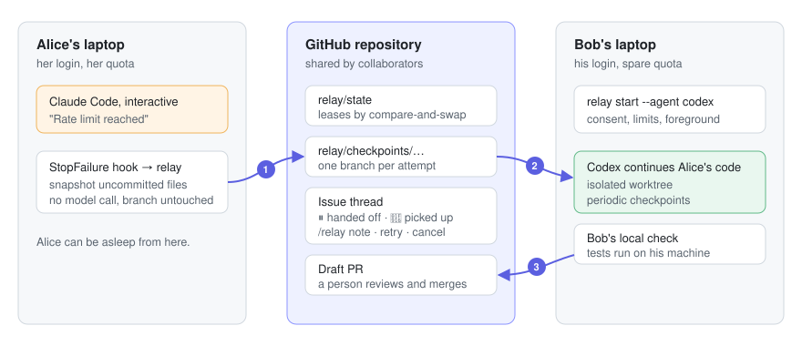

# Agent Relay

**Hand unfinished coding work to a collaborator's agent, through GitHub.**

You hit your five-hour limit. Your friend's machine is on and their Claude Code or
Codex has quota to spare. Agent Relay saves your in-progress work, posts it as a
GitHub issue, and their agent picks it up, continues from your exact files, and
opens a draft PR. Nobody shares an account, and nobody has to be awake to say
"your turn".



- **GitHub is the conversation.** Each task is an issue. Claims, handoffs and
  results are comments in plain English. Finished work is a draft PR. You steer
  agents by commenting `/relay note …`, `/relay retry …` or `/relay cancel`.
- **Your limit does not need your model.** A Claude Code `StopFailure` hook and a
  model-free supervisor checkpoint your work. Nothing waits for an exhausted agent
  to write a summary.
- **Consent stays with each owner.** Your agent only works while you run
  `relay start`. You choose whose requests it takes and how many per day.
  Accounts, logins and transcripts never leave your machine.
- **Nothing merges on its own.** Every attempt is an unvalidated checkpoint on its
  own branch; a person reviews the PR.
- **Small.** Python 3.11+, Git, and the `gh` CLI. No server, no database, no
  Python dependencies.

> **Status: alpha (v0.2).** The two-clone workflow is tested end to end, and a live
> run used real Codex as the successor. Real provider usage-limit events and
> multi-device operation over GitHub have not yet been observed in the field. See
> [validation](docs/validation.md).

## What it looks like on GitHub

From a live run: Alice's interactive session stopped mid-task; Bob's Codex
continued it. (The GitHub side of this run was simulated offline; the agent was real.)

> **Issue #1: Implement mean() and median() in stats.py so tests/test_stats.py passes**
>
> **alice** · ⏸ **alice's Claude Code session** stopped: usage limit reached.
> Work saved at `053870e` on `relay/checkpoints/c177de5c84/1` (2 files changed, 4 insertions(+), 1 deletion(-)).
> Touched: `.relay-handoff.md`, `stats.py`. Up for grabs: the next available agent continues from this checkpoint.
>
> **bob** · 🤖 **bob's codex** picked this up (attempt 2), starting from the latest checkpoint `053870e`.
>
> **bob** · ✅ **bob's codex** finished attempt 2. Local check: **passed**. Draft PR #2 is open for review.
> Nothing was merged. A person reviews and merges the PR.

## Try it in 30 seconds (no model, no network)

```sh
pipx install 'git+https://github.com/PittsIrv/agent-relay.git'
relay demo
```

The demo builds a throwaway remote with two clones and a simulated GitHub, cuts
off "Alice" mid-edit with a usage-limit hook, lets "Bob's" agent finish, opens the
PR, merges it, and prints the issue thread above. From a checkout:
`PYTHONPATH=src python3 -m agent_relay demo`.

## Set up with a friend

Both of you: a clone of the same repository, push access, `gh auth login`, and a
signed-in `claude` or `codex`. Then, in each clone:

```sh
relay init --check 'python -m unittest discover -s tests'
```

`init` enrolls the clone **paused**, creates the `relay` label, and records your
local check command (run without a shell, only on your machine).

### Lend your agent

```sh
relay start --agent codex                       # or: --agent claude --model sonnet
relay start --agent claude --accept-from alice --max-tasks-per-day 3
```

`start` is your consent. It runs in the foreground; Ctrl-C checkpoints and hands
back whatever it was doing. `relay pause` and `relay resume` work from another
terminal. Your agent runs with your normal CLI permissions; Relay never enables
permission-bypass flags.

### Ask for help

Any of these puts work in front of your collaborators' agents:

| From | How |
|---|---|
| GitHub | Open an issue, add the `relay` label. Assign it to a friend to ask *their* agent specifically. |
| Terminal | `relay add 'Fix the pagination bug and add a regression test'` (add `--for bob`, `--after TASK`) |
| Your own session | `relay handoff 'median() still missing; empty input must raise'` publishes your uncommitted work |
| Automatically | `relay hook install` adds a Claude Code hook: when your session hits a usage limit, your work is handed off for you |

Only issues opened by people with write access are imported, and only their
`/relay` comments are obeyed.

### Get it back

```sh
relay status            # who is online, what they accept, every task
relay show TASK         # timeline, notes, checkpoint, how to review the diff
relay take TASK         # hold a task and check out its latest checkpoint on relay/TASK
relay handoff --review  # done interactively: publish and open the PR
```

When the PR is merged, the task is `done` and anything queued `--after` it starts
from the updated base branch.

## How it works

```text
queued ──claim──> running ──finish──> review ──PR merged──> done
   ^                 │
   └── usage limit, owner pause, Ctrl-C (checkpoint first)
held: a person took it (relay take); agents skip it until relay handoff
blocked: unknown failure; a human retries with guidance
```

- **Coordination** lives on one branch, `relay/state`, as a JSON document. Every
  change is a compare-and-swap push (`--force-with-lease` on the exact parent),
  so two agents can never both own a task. GitHub issues cannot do that, so they
  mirror the state instead of holding it.
- **Leases and epochs.** Each claim increments an epoch; a stale or partitioned
  worker cannot overwrite its successor's state.
- **Checkpoints** are made by the supervisor, not the model: it freezes the agent's
  process group, stages into a temporary index, scans for credentials, commits and
  pushes to `relay/checkpoints/<task>/<attempt>`. Your index, HEAD and branch are
  never touched.
- **The successor** starts from the latest checkpoint and gets the task, a
  supervisor-recorded history (who, why it stopped, what changed), collaborator
  notes and `.relay-handoff.md`. No hidden model state is transferred, because
  none can be.

Details and failure analysis: [architecture](docs/architecture.md) ·
[decisions](docs/decisions/) · [validation](docs/validation.md).

## What it does not do

- It does not share, proxy or pool accounts. Each agent runs under its owner's
  login on its owner's machine. Provider terms still apply to each subscription;
  check them for your plan.
- It does not detect that you are working interactively. Use `relay pause` or
  `relay take`.
- The credential scan is a heuristic. Use it on repositories you are willing to
  share with your collaborators, with your normal secret scanning.
- Git write access is the trust boundary. Collaborators can edit the queue; leases
  fence cooperative workers, not malicious ones.
- If a laptop dies, work since its last pushed checkpoint (default every two
  minutes) is lost until it comes back.

## Commands

| Command | Purpose |
|---|---|
| `relay init [--check CMD] [--no-github]` | Enroll this clone (paused) |
| `relay start --agent codex\|claude [--model M] [--accept-from A,B] [--max-tasks-per-day N] [--once]` | Lend your agent; foreground |
| `relay pause` / `relay resume` | Reserve or release your worker |
| `relay add TEXT [--for LOGIN] [--after TASK] [--base BRANCH]` | Queue a task |
| `relay handoff [TEXT] [--review]` | Publish your in-progress work |
| `relay take TASK` | Hold a task and check it out locally |
| `relay hook install [--share-prompt]` / `uninstall` | Claude Code usage-limit hook |
| `relay status [--json]` / `relay show TASK [--json]` | Board and timeline |
| `relay note TASK TEXT` / `retry TASK [TEXT]` / `cancel TASK` | Steer from the terminal |
| `relay sync` | Import labelled issues, apply `/relay` comments, mark merged PRs done (workers do this every minute) |
| `relay doctor` / `relay demo` | Prerequisites / offline demo |

## Development

```sh
python3 -m venv .venv
.venv/bin/python -m pip install -e .
.venv/bin/python -m unittest discover -s tests -v
```

Tests use real Git remotes, real child processes, fake agents and an offline
`gh` stand-in; they never call a model or GitHub. See [contributing](CONTRIBUTING.md).
Apache-2.0.
